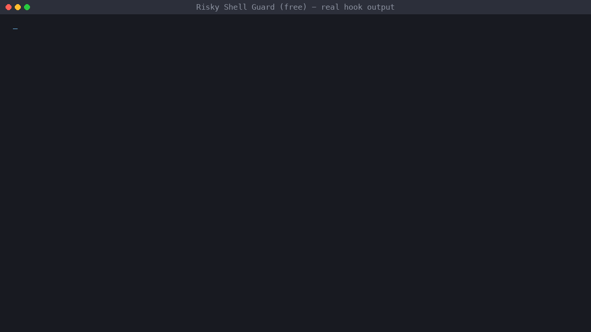

# Risky Shell Guard for Claude Code (free)

A single `PreToolUse` hook for Claude Code that blocks shell commands that are hard to undo: recursive deletes outside your project, force pushes, `git reset --hard`, `curl | sh`, `sudo` and a few more. Plain Python 3.9+, no dependencies, no network access.



*Recorded from this repository: the hook is copied into an empty project and given the same JSON that Claude Code sends before a Bash call. Only folder paths were shortened.*

## Install

As a plugin (Claude Code with plugin support):

```bash
claude plugin marketplace add keelwork-dev/claude-code-guardrails-free
claude plugin install risky-shell-guard@keelwork-guardrails
```

Or by hand: copy `hooks/block_risky_shell.py` and `hooks/guardrail_lib.py` into `<project>/.claude/hooks/` and add this to `<project>/.claude/settings.json`:

```json
{ "hooks": { "PreToolUse": [ { "matcher": "Bash", "hooks": [
  { "type": "command", "command": "python3 \"$CLAUDE_PROJECT_DIR/.claude/hooks/block_risky_shell.py\"" } ] } ] } }
```

Check it:

```bash
python3 tests/test_risky_shell_guard.py     # 21/21 checks passed
```

## Tested environments

| Check | Result (2026-11-22) |
|---|---|
| macOS (Apple silicon), Python 3.9.6 and 3.14 | self-test 21/21, manual install blocks commands |
| Ubuntu 26.04 LTS (aarch64, virtual machine), Python 3.9 and 3.12 | self-test 21/21, manual install blocks commands |
| Claude Code 2.1.330 on macOS | `claude plugin validate --strict` passes; plugin install from a local marketplace works; a real session blocked `git reset --hard` |
| Windows | not tested (WSL may work, but this has not been checked) |

Python 3.8 and older are not supported.

## What it blocks

| Blocked | Still allowed |
|---|---|
| `rm -rf` outside the project, or of `~`, `/`, the project root or `.git` | `rm -rf build/` and other deletes inside the project |
| `git push --force` / `--mirror` / `+branch`, deleting `main` or `master` (also on the remote) | normal pushes |
| `git reset --hard`, `git clean -f`, `git checkout .`, `git restore .` | `git status`, `git diff`, commits |
| `curl ... \| sh`, `wget ... \| bash` | downloading a file to read it first |
| `sudo`, `chmod -R 777`, `mkfs`, `dd of=/dev/...` | |
| `>` / `>>` / `tee` into files outside the project | redirects inside the project, heredoc text |

The hook understands `git -C <dir>`, `git -c k=v`, prefixes such as `env`, `nice`, `timeout`, and commands chained with `&&`, `;`, `|` or wrapped in `bash -c '...'`. Settings (protected branches, `allow_sudo`, `allow_force_push`) are read from `guardrails.json` in the folder above `hooks/`: for a manual install that is `<project>/.claude/guardrails.json`; the plugin install uses the built-in defaults. See [docs/hooks-explained.md](docs/hooks-explained.md) (it also describes the three hooks that are only in the paid kit) and [docs/five-commands.md](docs/five-commands.md) for the background.

When the hook blocks a command, Claude Code shows the reason to the agent, which then has to choose another approach. In one test session (Claude Code 2.1.330, Haiku model, plugin loaded with `--plugin-dir`) the agent was asked to run `git reset --hard HEAD` in a repository with one uncommitted change. The call never ran: the hook blocked it with *"`git reset --hard` throws away uncommitted work. Commit or stash first, or run it yourself."*, the agent reported the block and quoted that message without trying another way, and the uncommitted change was still there afterwards.

## Honest limits

- **Plugin install uses the defaults.** There is no settings file to edit in a plugin install, so messages that mention `allow_force_push` or `allow_sudo` only apply to a manual install with `<project>/.claude/guardrails.json`. If Claude Code does not pass `CLAUDE_PROJECT_DIR` to the hook, the hook cannot tell where your project is and blocks more than it should (for example `rm -rf build`); it fails closed, not open.

A hook is a safety net, not a sandbox. It reads the command text, so a script that the agent writes and then runs can still reach files the hook never sees. Keep backups, use version control, and review what you approve.

## The full kit

This repository is the free part of the **Guardrail Team Kit for Claude Code** (paid, $19): four hooks instead of one (project boundary, risky shell, secret leaks, commit gate), six subagents, four skills, a safe installer and an 85-check self-test, with English and Korean guides. 14-day refund for any reason.

https://keelwork.gumroad.com/l/guardrail-team-kit

## How this was made

Keelwork products are planned, written and tested by a small team of Claude Code agents, checked by a separate reviewer agent, and released only after the owner approves them. Issues and pull requests are welcome; they are read by the same agents and by the owner.

## License

MIT for everything in this repository (see `LICENSE`). The paid kit has its own license.

Independent project. Not affiliated with or endorsed by Anthropic. "Claude" and "Claude Code" are trademarks of Anthropic.
